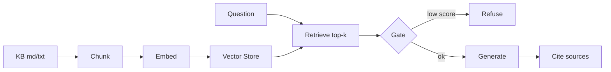

# Day 40 笔记｜里程碑：mini-rag

## 1. 今天学什么？

Phase 2 收官：不学新框架，把四周积木拼成**可演示作品**。

| 积木 | 来自 | 在里程碑里的角色 |
|------|------|------------------|
| 文档加载 / 清洗 | Day 31 | `load_documents` |
| 固定窗口 + overlap | Day 32 | `chunker` → 可配置切分 |
| 假向量 / Embedding 意识 | Day 33 | `fake_embed`（离线可复现） |
| 向量库 | Day 34 | `MiniCollection` |
| Retrieve → Prompt → Generate | Day 36 | `retrieve` + `build_rag_messages` |
| 引用来源 | Day 37 | `build_cited_answer` |
| 低相关拒答 | Day 38 | `evaluate_retrieval` + `format_refusal` |
| golden set 评测 | Day 39 | `run_eval` / Markdown 报告 |

前端类比：今天像把分散的 hooks/utils 收成一个可上线的「最小 App」——数据层（docs/chunks）、检索层（store）、策略层（gate）、展示层（citations）。

## 2. 核心对象怎么分层？

```text
main.py (ask / eval / demo)
  └─ MiniRag
       ├─ load_documents + chunker + index
       ├─ retrieve (rag_pipeline)
       ├─ evaluate_retrieval / format_refusal (refusal)
       ├─ generate_fn (可注入；默认 demo_generate)
       └─ build_cited_answer (citations)
```

原则：

1. **MiniRag 不重复实现余弦相似度**——那是 `vector_store` 的事  
2. **门控先于生成**：该拒就拒，省一次「胡说」  
3. **引用是展示策略**：`mode=all` 适合验收演示；`mentioned` 适合答案里已写 `[n]` 的真模型

## 3. 架构示意（mermaid）



## 4. 演示与真调

| 模式 | 怎么用 |
|------|--------|
| Demo（默认） | `python3 main.py demo` / `ask` / `eval`，假向量 + `demo_generate`，零费用 |
| 真 Embedding / Chat | 后续 Phase 可替换 `embed_fn` / `generate_fn`；本里程碑不强制 |

## 5. 坏回答复盘（请自己填写）

> 阶段验收要求：记录一次「坏回答或误拒答」并分析原因。

1. **现象**（答非所问 / 该拒没拒 / 该答却拒 / 引用错文档）：  
2. **可能原因**（切分？阈值？假向量主题锚点？golden 覆盖不够？）：  
3. **我会怎么改**（调 `min_top_score` / 改 chunk / 补文档 / 改 Prompt）：  

（可用 `python3 main.py ask "..."` 与 `eval` 对照观察。）

## 6. 今日一句话

> 里程碑的价值不是代码行数，而是：别人按 README 能跑起来，你能讲清每一层为什么存在。

## 7. 明日预告

Day 41 起进入 **Phase 3**：Chatbot vs Agent——开始认真对待「工具调用与行动循环」。

---

## 我的记录（请自己填写）

1.  
2.  
3.  
