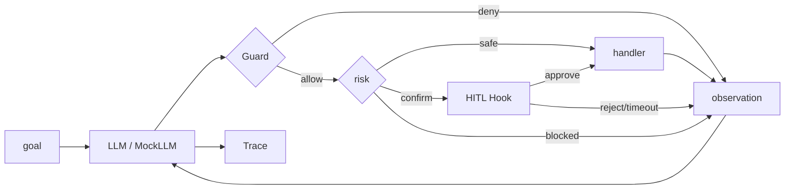

# Day 60 笔记｜里程碑：tool-agent

## 1. 今天学什么？

Phase 3 收官：不学新框架，把四周积木拼成**可演示作品**。

| 积木 | 来自 | 在里程碑里的角色 |
|------|------|------------------|
| Tool Schema / 双工具 | Day 42–45 | `tools.build_default_tools` |
| ReAct Loop + max_steps | Day 46–47 | `ToolAgent.run` |
| 错误回传 / Trace | Day 48–49 | observation JSON + `TraceStep` |
| 只读文件助手 | Day 50 | 沙箱 `Workspace` |
| 框架对照意识 | Day 51–55 | 先手写，再谈框架 |
| 注入案例 | Day 56 | 安全边界意识 |
| Guard 白名单 | Day 57 | `authorize` |
| Mock LLM | Day 58 | `MockLLM` + scenarios |
| HITL 确认 | Day 59 | `confirm` 档 + ScriptedConfirmHook |

前端类比：今天像把分散的 hooks（请求层、鉴权、二次确认 Modal、日志）收成一个可上线的「最小 App」。

## 2. 核心对象怎么分层？

```text
main.py (demo / scenario / report)
  └─ ToolAgent
       ├─ catalog (ToolSpec[])
       ├─ authorize (Guard)
       ├─ ConfirmHook (HITL)
       ├─ run(goal, llm=MockLLM|ChatFn)
       └─ TraceStep[] + acceptance report
```

原则：

1. **ToolAgent 不重复实现 Schema 校验**——那是 `guard` 的事  
2. **危险操作先问人再执行**：HITL 在 handler 之前  
3. **轨迹可回放**：调试靠 steps，不靠「我记得模型说过什么」

## 3. 架构示意（mermaid）



## 4. 演示与真调

| 模式 | 怎么用 |
|------|--------|
| Demo（默认） | `python3 main.py demo` / `scenario` / `report`，MockLLM，零费用 |
| 真 Chat API | 后续可把 `llm=` 换成真实客户端；本里程碑不强制 |

## 5. 坏轨迹复盘（请自己填写）

> 阶段验收要求：记录一次「坏轨迹」并分析原因。

1. **现象**（误退款 / 越权工具漏网 / 触顶无终答 / 路径越界）：  
2. **可能原因**（缺 Guard？HITL 钩子 AlwaysApprove？max_steps 太小？场景脚本写错？）：  
3. **我会怎么改**（升档风险 / 补断言 / 改 Prompt / 加超时默认拒绝）：  

（可用 `python3 main.py scenario refund_reject` 与 `blocked_shell` 对照观察。）

## 6. 今日一句话

> 里程碑的价值不是代码行数，而是：别人按 README 能跑起来，你能讲清每一层为什么存在。

## 7. 明日预告

Day 61 起进入 **Phase 4**：会话记忆回顾——开始认真对待「Agent 如何记住用户」。

---

## 我的记录（请自己填写）

1.  
2.  
3.  
