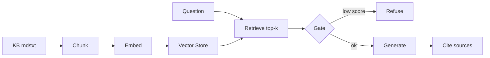

# mini-rag · Phase 2 里程碑

最小 RAG 问答系统：本地文档知识库 + 可配置切分 + 检索问答 + 引用溯源 + 低相关拒答 + golden set 评测。

> 本里程碑默认使用**确定性假向量**与 `demo_generate`，无需 API Key，可离线演示与回归。

## 能力

- 加载 `.txt` / `.md` 文档
- 可配置 `chunk_size` / `overlap`
- 问答返回答案 + 引用来源
- 低相关问题拒答（默认 `min_top_score=0.55`）
- 8 条 golden set 自动评测（命中 + 门控）
- `ask` / `eval` / `demo` 子命令

## 架构



## 安装

```bash
cd projects/mini-rag
python3 -m pip install --user -r requirements.txt
```

## 运行

演示 3 条问答（含 1 条应拒）：

```bash
python3 main.py demo
```

单次提问：

```bash
python3 main.py ask "RAG 为什么能降低幻觉"
python3 main.py ask "今天天气怎么样"
```

跑 golden set：

```bash
python3 main.py eval
```

可调切分与阈值：

```bash
python3 main.py --chunk-size 200 --overlap 40 --min-score 0.55 eval
```

## 测试

```bash
python3 -m pytest -q
```

## 模块结构

| 文件 | 职责 |
|------|------|
| `mini_rag.py` | 编排层：加载 / 切分索引 / ask / evaluate |
| `chunker.py` | 固定窗口 + overlap |
| `vector_store.py` | 内存向量库 |
| `rag_pipeline.py` | 检索与 Prompt 拼装 |
| `citations.py` | 引用来源格式化 |
| `refusal.py` | 拒答门控 |
| `rag_eval.py` | golden set 评测 |
| `main.py` | CLI 入口 |

## 学习来源

对应课程 Day 40：`daily/2026-09-16/`
