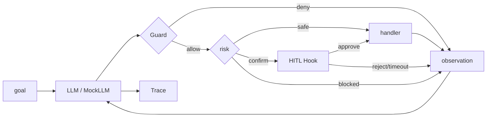

# tool-agent · Phase 3 里程碑

可演示的工具调用 Agent：多工具 + 手写 Loop + Guard 白名单 + HITL 确认 + Trace 回放 + Mock 场景验收。

> 本里程碑默认使用 **MockLLM** 与假 HTTP，无需 API Key，可离线演示与回归。

## 能力

- ≥3 个真实工具：`get_time` / `calculate` / `list_files` / `read_file` / `http_get` / `order_lookup`
- 手写 Agent Loop，可独立运行
- `max_steps` 防死循环
- 每步 Trace 可 Markdown 回放
- 安全：危险名拦截、沙箱只读、https host 白名单、`shell_exec` 永禁
- HITL：`refund_order` 执行前确认（批准 / 拒绝 / 超时）
- `demo` / `scenario` / `report` 子命令

## 架构



## 安装

```bash
cd projects/tool-agent
python3 -m pip install --user -r requirements.txt
```

## 运行

```bash
python3 main.py demo
python3 main.py scenario calc_time
python3 main.py scenario refund_approve
python3 main.py scenario refund_reject
python3 main.py scenario blocked_shell
python3 main.py report
```

## 测试

```bash
python3 -m pytest -q
```

## 模块结构

| 文件 | 职责 |
|------|------|
| `tool_agent.py` | 编排层：Loop / 场景 / 验收报告 |
| `tools.py` | 内置工具与沙箱工作区 |
| `guard.py` | 白名单 + Schema 校验 |
| `hitl.py` | 风险分级与确认钩子 |
| `mock_llm.py` | 离线脚本化 LLM |
| `trace.py` | 轨迹数据结构与 Markdown |
| `main.py` | CLI 入口 |

## 学习来源

对应课程 Day 60：`daily/2026-10-26/`
